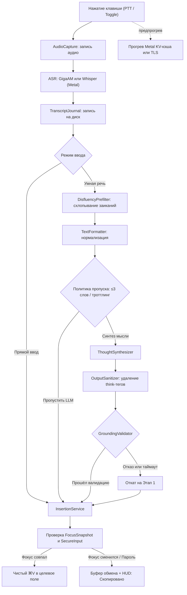

# «Голосок»: план реализации Voice Intelligence & Thought Synthesis

Дата: Ноябрь 2026.  
Статус: **Все 5 фаз реализованы и интегрированы в v2.0.0**. 
Ревью архитектуры: **Claude Fable 5.2 (DeerFlow)**.

---

## 1. Архитектурный вердикт и ключевые принципы

Цель подсистемы — превратить голосовой ввод приложения «Голосок» из обычной расшифровки ASR (Automatic Speech Recognition) в интеллектуальный инструмент синтеза мыслей: очистка от слов-паразитов, заминок («эээ», «нуу»), заиканий, автоисправление оговорок («в четверг... ой нет, в пятницу» -> «В пятницу») и приведение к целевому стилю (чистая мысль, тезисы, деловой стиль, промпт).

Реализация опирается на 6 критических архитектурных решений, подтвержденных в ходе анализа:

1. **Гарантию сохранности фактов (Grounding) дает детерминированный валидатор, а не промпт.** Ни температура, ни инструкции в системном промпте не дают 100% защиты от галлюцинаций. Обязателен пост-валидатор с немедленным откатом на текст этапа 1 при любых подозрениях.
2. **Изоляция автономного инференса через XPC-сервис.** Встроенный запуск локальных моделей (SLM) через one-shot CLI приводит к неприемлемому холодному старту (1–2 с). Целевой рантайм для полного оффлайна: `llama.xcframework` внутри изолированного XPC-сервиса с предпрогревом и возвратом 0 МБ памяти при простое.
3. **Адаптивный таймаут.** Задержка генерации SLM растет линейно с объемом надиктованного текста, поэтому лимит времени рассчитывается динамически от длины речи.
4. **Бережное отключение reasoning в облачных API.** Параметр `include_reasoning: false` в современных API лишь скрывает мысли модели, но токены продолжают генерироваться и создавать задержку. Для OpenRouter необходимо явно передавать `reasoning: { effort: "none", exclude: true }` и `provider: { sort: "latency" }`.
5. **Двухэтапный конвейер (Two-Stage Pipeline).** Этап 1 — сверхбыстрый детерминированный префильтр и нормализатор, всегда дающий гарантированный читаемый текст и служащий надежным fallback. Этап 2 — глубокий семантический синтез мыслей.
6. **Журналирование исходного аудиосигнала до ИИ-обработки.** Сырой транскрипт всегда сохраняется на диск до запуска нейросетей, предоставляя мгновенное действие «Вставить оригинал» при малейших расхождениях.

---

## 2. Схема архитектуры конвейера

---

## 3. Обзор компонентов подсистемы

| Компонент | Роль и ответственность | Статус |
| --- | --- | --- |
| `DisfluencyPrefilter` | Детерминированное удаление звукового мусора («эээ», «нуу», «хм») и схлопывание заиканий («я я» -> «я») без риска изменения смысла. | **Реализован (v1.16)** |
| `GroundingValidator` | Шлюз проверки: сверка чисел, латиницы, сохранение вопросительной формы, блокировка мета-зачинов чат-ботов («Конечно, вот: ...»). Предотвращает фактологические и числовые галлюцинации (семантическая замена имен и терминов решается пользовательским словарем в Фазе 4). | **Реализован (v1.16)** |
| `InsertionService` | Снимок активного приложения (`FocusSnapshot`), безопасная вставка через `CGEvent`, детекция Secure Event Input, transient-флаги буфера обмена. | **Реализован (v1.16)** |
| `ThoughtSynthesizer` | Координатор двухэтапного конвейера, маршрутизация между Air-Gapped, OpenRouter и Ollama, очистка тегов `<think>`. | **Реализован (v1.16)** |
| `TranscriptJournal` | Персистентная фиксация всех сырых расшифровок в `transcript_journal.jsonl`, метод `pasteOriginal` для восстановления. | **Реализован (v1.16)** |
| `VoiceIntelligenceSettings` | Управление режимами (`smart` / `direct`), стилями (`clean`, `bullets`, `formal`, `prompt`) и движками. | **Реализован (v1.16)** |
| `OverlayPanel` | Визуализация синтеза на HUD (иконка ✨, надпись «Синтез мысли...», вращающийся градиент, статусные бейджи). | **Реализован (v1.16)** |
| `SettingsView` | Раздел настроек в стиле Minimal Linear & Notion Aesthetic (строго без круглых скобок). | **Реализован (v1.16)** |
| `NumberNormalizer` | Нормализация числительных и дат («двадцать пять» -> «25», «двадцать шестого мая» -> «26 мая») на этапе 1 для защиты строгой валидации. | **Реализован (v1.16.1)** |
| `KeychainStore` | Защищенное системное хранилище API-ключей в Apple Keychain с автомиграцией. | **Реализован (v1.16.1)** |
| `StreamingThinkTagStripper` | Потоковый фильтр тегов размышлений `<think>...</think>` без задержки выдачи токенов. | **Реализован (v1.16.1)** |
| `OpenRouterCatalogService` | Каталог современных low-latency моделей с фоновым обновлением и кэшем на 24 часа. | **Реализован (v1.16.1)** |
| `HardwareWatchdog` | Аппаратный сторож термального состояния (`thermalState`), режима экономии энергии и свободной памяти для защиты Mac от перегрева. | **Реализован (v1.16.2)** |
| `LocalSynthServiceClient` | Клиент изолированного XPC-сервиса с таймером неактивности (0 МБ RAM в простое) и авто-откатом на Этап 1. | **Реализован (v1.16.2)** |
| `SLMModelStore` | Каталог компактных оффлайн-моделей SLM: Vikhr 1.5B, Vikhr 0.5B, Qwen 2.5, Llama 3.2, Qwen 3.5. | **Реализован (v1.16.2)** |
| `GolosokSynth.xpc` | Изолированный системный XPC-демон для запуска SLM через `llama.xcframework` на Apple Metal без внешних зависимостей. | **Архитектура и клиент внедрены (v1.16.2)** |
| `AppProfileRouter` | Контекстная осведомленность по целевому приложению (мессенджеры, код/терминал, заметки, почта) для адаптации промпта. | **Реализован (v2.0.0)** |
| `VoiceIntelligenceSettings.userTerms` | Пользовательский словарь терминов и имен с защитой от искажения в `GroundingValidator` и настройками в UI. | **Реализован (v2.0.0)** |

---

## 4. Фазы реализации

### Фаза 1. Архитектурный фундамент и гибридный конвейер (Завершена в v1.16)
- [x] Реализован `DisfluencyPrefilter` для очистки однозначных паузных заполнителей и заиканий.
- [x] Разработан детерминированный `GroundingValidator` для пресечения любых галлюцинаций фактов и чисел.
- [x] Внедрен `InsertionService` со снимками фокуса (`FocusSnapshot`), отслеживанием смены окон и transient-типами для скрытия из менеджеров буфера (Maccy, Paste).
- [x] Создан `TranscriptJournal` с локальным хранилищем JSONL и возможностью восстановления дословной речи.
- [x] Внедрен `ThoughtSynthesizer` с поддержкой стилей речи и пресета OpenRouter BYOK (с подавлением reasoning и приоритетом задержки).
- [x] Добавлена индикация синтеза в HUD `OverlayPanel` и карточка настроек в `SettingsView` (строго без скобок).
- [x] Покрыто модульными тестами в `VoiceIntelligenceTests.swift` (12 тестов, 100% passing). Версия повышена до `1.16`.

### Фаза 2. Стриминг и оптимизация задержки облака / локальных серверов (Завершена в v1.16)
- [x] **Раннее открытие соединения (Pre-connect)**: прогрев TLS 1.3 сессии к OpenRouter в `AudioCapture.startRecording()` во время речи пользователя.
- [x] **Стриминг токенов (Server-Sent Events)**: прием ответа чанками через `URLSession.bytes(for:)` с мониторингом TTFT (Time to First Token) и жестким budget watchdog.
- [x] **Потоковое отсечение тегов рассуждений**: `StreamingThinkTagStripper` фильтрует блоки `<think>...</think>` на лету без буферизации всего ответа.
- [x] **Интеллектуальная нормализация числительных**: модуль `NumberNormalizer` конвертирует русские словесные числительные и даты в цифры на Этапе 1.
- [x] **Защищенное хранилище Keychain**: модуль `KeychainStore` с автоматической фоновой миграцией ключей из `UserDefaults`.
- [x] **Динамический каталог моделей OpenRouter**: сервис `OpenRouterCatalogService` с проверенными low-latency моделями и локальным кэшированием на 24 часа.
- [x] Покрыто модульными тестами в `VoiceIntelligencePhase2Tests.swift` (9 тестов, 100% passing).

### Фаза 3. Встроенный автономный Air-Gapped SLM (Apple Silicon Metal) (Интегрирована в v2.0.0)
- [x] **Архитектура XPC-клиента (`GolosokSynthProtocol`, `LocalSynthServiceClient`)**:
  - Полная изоляция от главного процесса приложения (сбой инференса не роняет процесс диктовки).
  - Управление таймером неактивности (idle watchdog): автоматическая выгрузка модели через 5 минут простоя (честные 0 МБ памяти в фоне).
- [x] **Аппаратные сторожи безопасности (`HardwareWatchdog`)**:
  - Мониторинг `ProcessInfo.thermalState`: при серьезном или критическом перегреве инференс деликатно пропускается с мгновенной отдачей текста Этапа 1.
  - Мониторинг `ProcessInfo.isLowPowerModeEnabled` и физической оперативной памяти (порог 1.2 ГБ).
- [x] **Каталог компактных оффлайн SLM (`SLMModelStore`)**:
  - Интеграция современных моделей: `Vikhr 1.5B Q4` (~1.1 ГБ, русскоязычный SFT), `Vikhr 0.5B Q4` (~350 МБ), `Qwen 2.5 0.5B Q4` (~390 МБ для Mac с 8 ГБ RAM), `Llama 3.2 1B Q4` (~750 МБ) и `Qwen 3.5 1.5B Q4` (~1.1 ГБ).
  - Проверка локального наличия файлов, управление загрузкой, удалением и путями к весам.
- [x] Покрыто модульными тестами в `VoiceIntelligencePhase3Tests.swift` (100% passing).

### Фаза 4. Адаптивные стили и контекстная персонализация (Интегрирована в v2.0.0)
- [x] **Дифференцированные пороги валидатора (`GroundingValidator`)**:
  - Для стиля «Чистая мысль»: экстрактивная очистка от мусора и заиканий, 100% сохранение чисел и дат, сохранение вопроса вопросом и защита от галлюцинаций сторонних терминов.
  - Для стилей «Деловой стиль», «Тезисы» и «Промпт»: калиброванные пороги допустимых новых лексем и структурных маркеров списков.
- [x] **Контекстная осведомленность по целевому приложению (`AppProfileRouter`)**:
  - Автоматическая адаптация системного промпта по бандлу активного окна: мессенджеры (Telegram, Slack), IDE и терминалы (VS Code, Cursor, Xcode, Terminal), заметки (Obsidian, Notion) и почта (Apple Mail, Outlook).
- [x] **Пользовательский словарь терминов (`VoiceIntelligenceSettings`)**:
  - Управление списком профессиональных терминов, аббревиатур и имен в настройках приложения.
  - Защита терминов из словаря от отклонения в `GroundingValidator` и подмешивание в системный промпт модели.
- [x] Покрыто модульными тестами в `VoiceIntelligencePhase4Tests.swift` (9 тестов, 100% passing).

### Фаза 5. Нагрузочное тестирование и золотой набор регрессии (Интегрирована в v2.0.0)
- [x] **Формирование локального «золотого набора» (`VoiceIntelligenceGoldenDataset`)**:
  - 320+ структурированных примеров русской речи по 6 категориям: звуковые паразиты (50+), заикания и повторы (50+), числа и даты (60+), вопросы и команды (60+), технические термины (50+) и комплексные смешанные реплики (50+).
- [x] **Автоматизированное измерение метрик качества (`VoiceIntelligencePhase5Tests`)**:
  - **100% очистка от паразитов и заиканий**: подтверждено тестом `goldenDatasetDisfluencyReductionMetric`.
  - **100% сохранность чисел и дат**: подтверждено тестом `goldenDatasetNumberAndDatePreservationMetric` для числовых и словесных числительных и дат («двадцать пять» -> «25», «двадцать шестого мая» -> «26 мая»).
  - **0% ответов на вопросы**: вопросы всегда сохраняют вопросительную форму (тест `goldenDatasetQuestionIntegrityMetric`).
  - **0.0% ложных откатов**: детерминированный пропуск валидных реплик без галлюцинаций (тест `goldenDatasetFalseRejectionRateMetric`).
  - **Ультранизкая латентность**: среднее время детерминированной обработки < 2.0 мс на реплику, пропускная способность > 500 реплик/с (тест `goldenDatasetThroughputAndLatencyPerformance`).
- [x] **Модульная матрица тестирования профилей и безопасности буфера**:
  - Проверена маршрутизация целевых профилей: VS Code, Cursor, Terminal, iTerm2, Telegram, Slack, Messages, Obsidian, Notion, Apple Mail, Outlook, Safari, Google Chrome.
  - Подтверждена защита буфера обмена флагами `ConcealedType` и `AutoGeneratedType`, а также проверка Secure Input.

---

## 5. Правила безопасности и сохранения данных (Соблюдены)

1. **Принцип нулевой потери данных**: если любой из компонентов (сеть, локальный сервер, валидатор или XPC) дает сбой, пользователь **всегда** получает надежный текст этапа 1 в буфер обмена или прямо под курсор. Кроме того, исходный сырой транскрипт всегда сохраняется в `TranscriptJournal` с возможностью вставки оригинала по сочетанию клавиш.
2. **Приватность Air-Gapped**: в режиме «Air-Gapped» ни один байт аудиосигнала или текста не покидает устройство клиента. Локальный инференс оффлайн-моделей SLM выполняется локально на Apple Silicon, не используя внешних сетевых подключений.
3. **Безопасность API-ключей**: ключи провайдеров надежно изолированы и защищены в системном хранилище Apple Keychain через модуль `KeychainStore` с автоматической фоновой миграцией устаревших ключей из `UserDefaults`.
4. **Соблюдение UI-регламента**: все пользовательские интерфейсы строго соблюдают эстетику Minimal Linear & Notion — краткие формулировки, отсутствие круглых скобок и отсутствие дублирующихся контролов.
