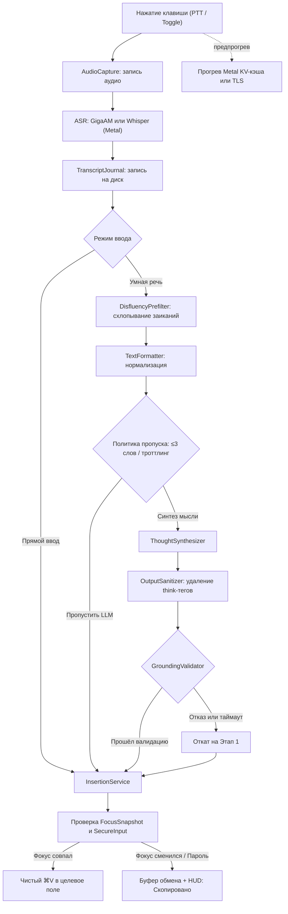

# «Голосок»: план реализации Voice Intelligence & Thought Synthesis

Дата: Ноябрь 2026.  
Статус: **Фаза 1 выполнена (v1.16)**. План следующих этапов развития подсистемы.  
Ревью архитектуры: **Claude Fable 5.2 (DeerFlow)**.

---

## 1. Архитектурный вердикт и ключевые принципы

Цель подсистемы — превратить голосовой ввод приложения «Голосок» из обычной расшифровки ASR (Automatic Speech Recognition) в интеллектуальный инструмент синтеза мыслей: очистка от слов-паразитов, заминок («эээ», «нуу»), заиканий, автоисправление оговорок («в четверг... ой нет, в пятницу» -> «В пятницу») и приведение к целевому стилю (чистая мысль, тезисы, деловой стиль, промпт).

Реализация опирается на 6 критических архитектурных решений, подтвержденных в ходе анализа:

1. **Гарантию сохранности фактов (Grounding) дает детерминированный валидатор, а не промпт.** Ни температура, ни инструкции в системном промпте не дают 100% защиты от галлюцинаций. Обязателен пост-валидатор с немедленным откатом на текст этапа 1 при любых подозрениях.
2. **Изоляция автономного инференса через XPC-сервис.** Встроенный запуск локальных моделей (SLM) через one-shot CLI приводит к неприемлемому холодному старту (1–2 с). Целевой рантайм для полного оффлайна: `llama.xcframework` внутри изолированного XPC-сервиса с предпрогревом и возвратом 0 МБ памяти при простое.
3. **Адаптивный таймаут.** Задержка генерации SLM растет линейно с объемом надиктованного текста, поэтому лимит времени рассчитывается динамически от длины речи.
4. **Бережное отключение reasoning в облачных API.** Параметр `include_reasoning: false` в современных API лишь скрывает мысли модели, но токены продолжают генерироваться и создавать задержку. Для OpenRouter необходимо явно передавать `reasoning: { effort: "none", exclude: true }` и `provider: { sort: "latency" }`.
5. **Двухэтапный конвейер (Two-Stage Pipeline).** Этап 1 — сверхбыстрый детерминированный префильтр и нормализатор, всегда дающий гарантированный читаемый текст и служащий надежным fallback. Этап 2 — глубокий семантический синтез мыслей.
6. **Журналирование исходного аудиосигнала до ИИ-обработки.** Сырой транскрипт всегда сохраняется на диск до запуска нейросетей, предоставляя мгновенное действие «Вставить оригинал» при малейших расхождениях.

---

## 2. Схема архитектуры конвейера

---

## 3. Обзор компонентов подсистемы

| Компонент | Роль и ответственность | Статус |
| --- | --- | --- |
| `DisfluencyPrefilter` | Детерминированное удаление звукового мусора («эээ», «нуу», «хм») и схлопывание заиканий («я я» -> «я») без риска изменения смысла. | **Реализован (v1.16)** |
| `GroundingValidator` | Шлюз проверки: сверка чисел, латиницы, сохранение вопросительной формы, блокировка мета-зачинов чат-ботов («Конечно, вот: ...»). | **Реализован (v1.16)** |
| `InsertionService` | Снимок активного приложения (`FocusSnapshot`), безопасная вставка через `CGEvent`, детекция Secure Event Input, transient-флаги буфера обмена. | **Реализован (v1.16)** |
| `ThoughtSynthesizer` | Координатор двухэтапного конвейера, маршрутизация между Air-Gapped, OpenRouter и Ollama, очистка тегов `<think>`. | **Реализован (v1.16)** |
| `TranscriptJournal` | Персистентная фиксация всех сырых расшифровок в `transcript_journal.jsonl`, метод `pasteOriginal` для восстановления. | **Реализован (v1.16)** |
| `VoiceIntelligenceSettings` | Управление режимами (`smart` / `direct`), стилями (`clean`, `bullets`, `formal`, `prompt`) и движками. | **Реализован (v1.16)** |
| `OverlayPanel` | Визуализация синтеза на HUD (иконка ✨, надпись «Синтез мысли...», вращающийся градиент, статусные бейджи). | **Реализован (v1.16)** |
| `SettingsView` | Раздел настроек в стиле Minimal Linear & Notion Aesthetic (строго без круглых скобок). | **Реализован (v1.16)** |
| `GolosokSynth.xpc` | Изолированный системный XPC-демон для запуска SLM через `llama.xcframework` на Apple Metal без внешних зависимостей. | *Фаза 3* |
| `ModelStore (SLM)` | Фоновая загрузка квантованных GGUF-весов по требованию с проверкой SHA-256 хеша. | *Фаза 3* |

---

## 4. Фазы реализации

### Фаза 1. Архитектурный фундамент и гибридный конвейер (Завершена в v1.16)
- [x] Реализован `DisfluencyPrefilter` для очистки однозначных паузных заполнителей и заиканий.
- [x] Разработан детерминированный `GroundingValidator` для пресечения любых галлюцинаций фактов и чисел.
- [x] Внедрен `InsertionService` со снимками фокуса (`FocusSnapshot`), отслеживанием смены окон и transient-типами для скрытия из менеджеров буфера (Maccy, Paste).
- [x] Создан `TranscriptJournal` с локальным хранилищем JSONL и возможностью восстановления дословной речи.
- [x] Внедрен `ThoughtSynthesizer` с поддержкой стилей речи и пресета OpenRouter BYOK (с подавлением reasoning и приоритетом задержки).
- [x] Добавлена индикация синтеза в HUD `OverlayPanel` и карточка настроек в `SettingsView` (строго без скобок).
- [x] Покрыто модульными тестами в `VoiceIntelligenceTests.swift` (12 тестов, 100% passing). Версия повышена до `1.16`.

### Фаза 2. Стриминг и оптимизация задержки облака / локальных серверов
- [ ] **Раннее открытие соединения (Pre-connect)**: открытие TLS-сессии к OpenRouter в момент нажатия клавиши Push-to-Talk, пока пользователь говорит.
- [ ] **Стриминг токенов (Server-Sent Events)**: прием ответа по частям с мониторингом TTFT (Time to First Token) и жестким сторожем общего времени (budget watchdog).
- [ ] **Интеллектуальная нормализация числительных**: предварительная конвертация числительных («двадцать пять» -> «25») до отправки в модель для идеальной работы строгой проверки чисел.
- [ ] **Динамический каталог моделей OpenRouter**: загрузка свежего списка быстрых моделей через API с автоматической фильтрацией моделей, требующих неотключаемый reasoning.

### Фаза 3. Встроенный автономный Air-Gapped SLM (Apple Silicon Metal)
- [ ] **Разработка XPC-сервиса `GolosokSynth.xpc`**:
  - Полная изоляция от главного процесса (сбой или утечка памяти в инференсе не влияет на диктовку).
  - Интеграция `llama.xcframework` с бэкендом Metal.
  - Честные 0 МБ оперативной памяти в фоне: завершение XPC-сервиса по таймеру простоя (например, через 5 минут после последней диктовки).
- [ ] **Поддержка компактных моделей SLM (1.5B – 3B)**:
  - Интеграция русскоязычной модели `Vikhr-Qwen-2.5-1.5B-Instruct-GGUF` (Q4_K_M, ~1.1 ГБ).
  - Предпрогрев модели и кэширование системного промпта в KV-кэше во время удержания клавиши записи.
- [ ] **Аппаратные сторожи безопасности**:
  - Проверка `ProcessInfo.thermalState` и режима энергосбережения: при перегреве или низком заряде синтез автоматически пропускается с мгновенной отдачей текста этапа 1.

### Фаза 4. Адаптивные стили и контекстная персонализация
- [ ] **Дифференцированные пороги валидатора**:
  - Для стиля «Чистая мысль»: нулевой допуск новых слов (строго экстрактивный режим).
  - Для стилей «Деловой стиль» и «Промпт»: калиброванные пороги допустимых новых лексем.
- [ ] **Контекстная осведомленность по целевому приложению**:
  - Автоматическая адаптация стиля в зависимости от бандла активного окна (например, лаконичный стиль для Telegram/Slack, формальный для Mail, Markdown-разметка для Obsidian/Notion).
- [ ] **Пользовательский словарь терминов**:
  - Возможность задать в настройках персональный список профессиональных терминов, аббревиатур и имен, которые валидатор обязан защищать.

### Фаза 5. Нагрузочное тестирование и золотой набор регрессии
- [ ] Формирование локального «золотого набора» из 300+ аудиопримеров с русской речью (разговорная речь, заикания, термины, числа, вопросы).
- [ ] Автоматизированное измерение метрик:
  - 0% ответов на надиктованные вопросы (вопросы всегда остаются вопросами).
  - 100% сохранность чисел и дат.
  - Доля ложных откатов < 5%.
- [ ] Матрица интеграционного тестирования вставки: VS Code, Terminal, Telegram, Slack, Safari, Google Chrome, текстовые поля с защищенным вводом пароля.

---

## 5. Правила безопасности и сохранения данных

1. **Принцип нулевой потери данных**: если любой из компонентов (сеть, локальный сервер, валидатор или XPC) дает сбой, пользователь **всегда** получает текст этапа 1 в буфер обмена или прямо под курсор.
2. **Приватность Air-Gapped**: в режиме «Air-Gapped» ни один байт аудиосигнала или текста не покидает устройство клиента; доступ к сети в данном режиме полностью заблокирован.
3. **Безопасность API-ключей**: ключ OpenRouter сохраняется исключительно в системном защищенном хранилище Apple Keychain.
4. **Соблюдение UI-регламента**: все пользовательские интерфейсы строго соблюдают эстетику Minimal Linear & Notion — краткие формулировки, отсутствие круглых скобок и отсутствие дублирующихся контролов.
